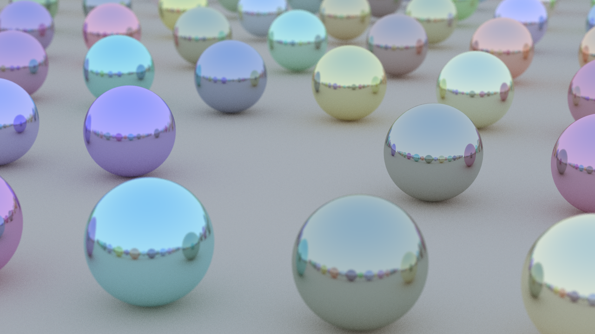

<h1 align="center">Лабораторная работа №4</h1>

<h2> Цель лабораторной работы: </h2>
<h5> Реализовать алгоритм трассировки лучей.</h5>
<h6>Язык: Python</h6>
<h6>  
	Сгенерированная сцена должна содержать 5-10 сфер разных цветов и 1-2 источника света.
	Максимальная глубина рекурсии - 5. Все объекты сцены не должны быть прозрачными. 
</h6>

<h2> Описание проделанной работы: </h2>
<h5> 
В результатет выполнения данной работы был реализован алгоритм трассировки лучей. 
Вычисления производились на GPU с применением CUDA.
</h5>

<h2> Что было распараллелено: </h2>
<h5> Для избежания переполнения памяти лучи обрабатываются чанками (группой блоков). Это позволяет каждому потоку CUDA обрабатывать свой набор лучей.</h5>

<h2> Как производились вычисления: </h2>
<h5> 
 
1. Генерация сцены.

2. Заполнение сцены сферами разного цвета.

3. Инициализация камеры.

4. Создание буферов для объектов сцены (их параметров).

5. Генерация случайных векторов.

6. Начало отсчёта времени для трассировки лучей.

7. Трассировка лучей:

	1) Проверка пересечения лучей и объектов.

	2) Обработка попаданий и непопаданий.

	3) Обработка отражений.

	4) Увеличение счётчика отражений.

	5) Усреднение цвета.

	6) Гамма-коррекция.

8. Завершение трассировки, конец отсчёта времени, сохранение результата.
 
</h5>

<h2> Оборудование: </h2>
<h5>  	
GPU: NVIDIA GeForce GTX 1060 6GB  
</h5>  
 
<h2> Результат: </h2>

 

